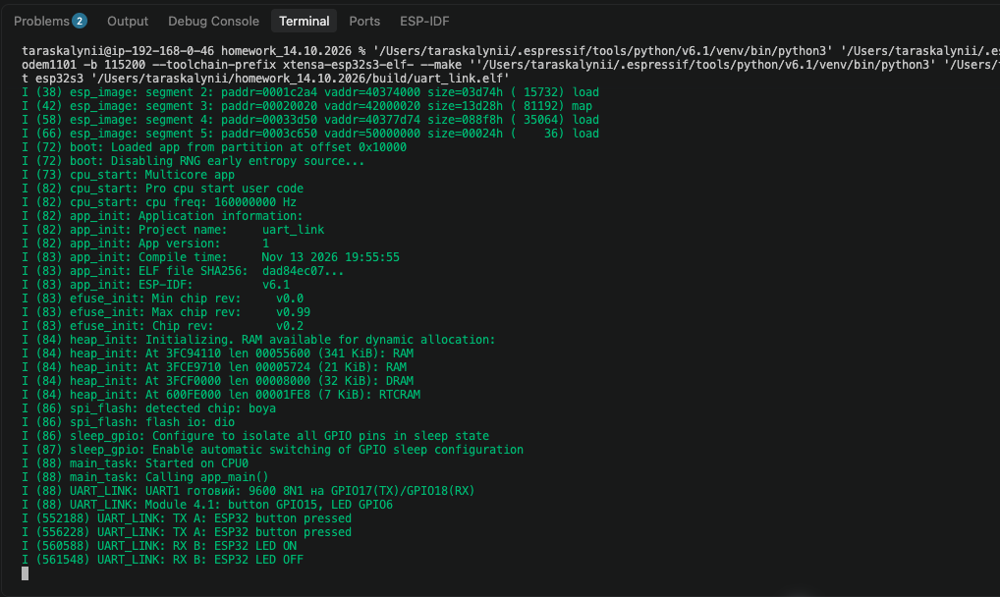
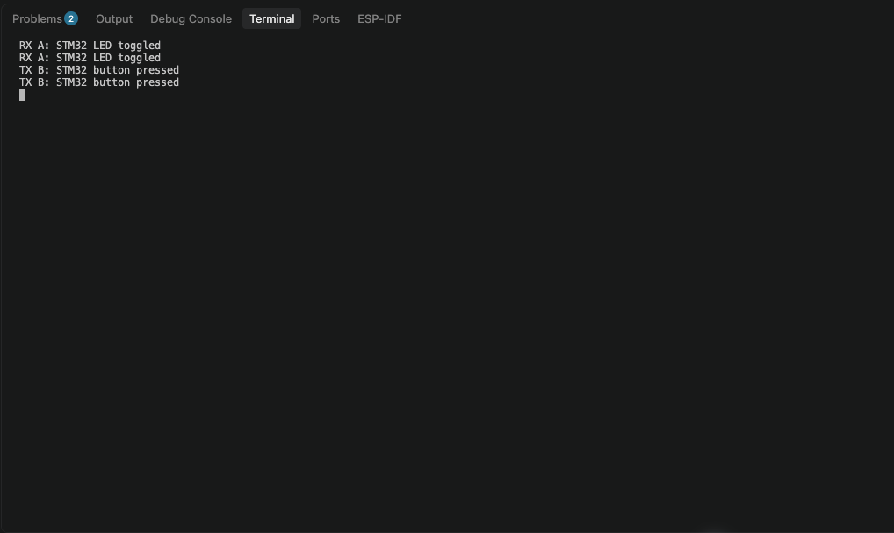

# Модуль 4.1 · UART між ESP32-S3 та STM32

Кнопка на ESP32-S3 надсилає байт `A` і перемикає світлодіод STM32. Кнопка `KEY` на STM32 надсилає байт `B` і перемикає світлодіод ESP32-S3. Кожне натискання надсилає одну команду після усунення брязкоту контактів.

## Підключення

UART1 / USART1 працюють на **9600 бод, 8N1**, без керування потоком.

| ESP32-S3 | STM32F411 |
| --- | --- |
| GPIO17 (TX) | PA10 (RX) |
| GPIO18 (RX) | PA9 (TX) |
| GND | GND |

На ESP32-S3 підключи кнопку між **GPIO15** і **GND**. Підтяжку ввімкнено в коді. Підключи **GPIO6** через резистор **330 Ом** до анода світлодіода, а катод світлодіода до **GND**. На STM32 використовуються вбудовані кнопка **KEY (PA0)** і світлодіод **PC13**.

## Як використати код

- **ESP32-S3.** Скопіюй [main.c](esp32-s3/main.c) у `main/` проєкту ESP-IDF. У `idf_component_register()` вкажи `SRCS "main.c"` та `PRIV_REQUIRES esp_driver_gpio esp_driver_uart`. Збери й проший із ціллю `esp32s3`.
- **STM32F411.** Скопіюй [app.c](stm32/app.c) у `Core/Src/`, а [app.h](stm32/app.h) у `Core/Inc/` проєкту STM32CubeIDE. Налаштуй USART1 і GPIO за схемою вище, увімкни USB Device CDC. У `main.c` підключи `app.h`, виклич `setup()` після ініціалізації GPIO, USB і USART1 та викликай `loop()` всередині `while (1)`.

## Результат

**ESP32-S3.** `TX A` після натискання локальної кнопки. `RX B` і `LED ON/OFF` після двох натискань кнопки STM32.

**STM32.** `RX A` підтверджує прийом команди від ESP32-S3 і перемикання LED. `TX B` з’являється після натискання кнопки STM32. Логи доступні через USB CDC.

