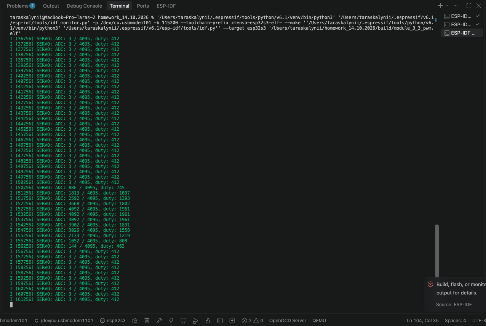

# Module 3.5 — керування сервоприводом потенціометром

Домашнє завдання Beetroot Academy, Embedded Development.
Плата: **ESP32-S3 N16R8**, **ESP-IDF v6.1**, мова C.
Гілка: `module-3-5-servo`.

## Робота програми

Потенціометр на **GPIO1 / ADC1_CH0** задає положення сервоприводу на **GPIO4**.
Автоматичного руху немає: після зупинки ручки серво утримує задане положення.

- АЦП: 12 біт, `ADC_ATTEN_DB_12`, сирі значення 0…4095.
- Усереднення 16 вимірювань і фільтр із коефіцієнтом 1/4.
- Оновлення приблизно кожні 20 мс; зона нечутливості — 4 відліки duty.
- LEDC: 50 Гц, 14 біт, low-speed mode, таймер 0, канал 0.
- Імпульси приблизно 500…2400 мкс, duty 409…1965.
- Раз на 500 мс у консолі виводяться ADC та duty.

```c
duty = 409 + raw * (1965 - 409) / 4095;
```

Сирі покази АЦП не є напругою або виміряним кутом.

## Підключення

| Контакт | Підключення |
|---|---|
| Крайні контакти потенціометра | 3V3 і GND |
| Середній контакт потенціометра | GPIO1 |
| Сигнал сервоприводу | GPIO4 |
| Живлення SG90 | Відповідне джерело 5 В |
| Земля сервоприводу | Спільна з GND ESP32 |

На GPIO1 не подавати 5 В. Підключення змінювати при вимкненому живленні.
Щоб змінити напрямок керування, поміняти місцями крайні контакти потенціометра.

## Збірка та прошивання

В активованому середовищі ESP-IDF v6.1:

```sh
idf.py set-target esp32s3
idf.py build
idf.py -p /dev/cu.usbmodem1101 -b 115200 flash
idf.py -p /dev/cu.usbmodem1101 monitor
```

Назва порту залежить від комп’ютера. `sdkconfig.defaults` задає ESP32-S3,
flash 16 МБ, DIO 80 МГц і дублювання консолі через USB Serial/JTAG.
Перед записом закрити монітор, що займає порт.

## Результат

[Поточний main.c](main/main.c) перенесено без змін із робочого проєкту.
Код зібрано для ESP32-S3 з ESP-IDF v6.1.
На наданому користувачем скріні під час повороту ручки ADC змінюється
приблизно від 3 до 4092, duty — від 412 до 1961, після чого повертається вниз.



[Приклади фактичних значень і межі перевірки](docs/results.md).

## Відповідність умові LMS

Умова Module 3.5 вимагає відповідності кутів потенціометра й серво 1:1,
обрізання неспільної частини діапазону та логування кута від лівого краю.
Поточний варіант масштабує весь діапазон ADC на заданий діапазон імпульсів,
логує ADC і duty. Механічні кути не калібровано, співвідношення 1:1 не
підтверджено, кут у градусах не логується. Опубліковано саме перевірений
користувачем код без додаткових змін його поведінки.
