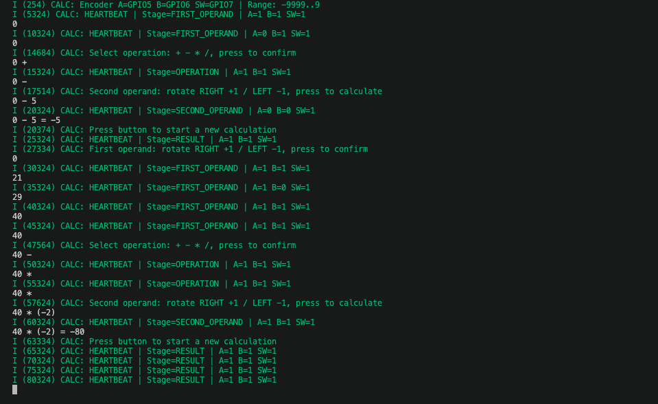

# Модуль 3 — мініпроєкт «Калькулятор» (заняття 37)

ESP32-S3, ESP-IDF 6.1. Енкодер: A=GPIO5, B=GPIO6, SW=GPIO7.
Схема може залишитися від попередніх завдань; серво та бузер не використовуються,
їхні керуючі GPIO1 і GPIO2 встановлюються в LOW.

## Керування

1. Обертання RIGHT збільшує перше число на 1, LEFT зменшує на 1.
2. Натискання підтверджує число та переходить до вибору операції.
3. Обертання перемикає +, -, *, /. Натискання підтверджує операцію.
4. Обертання задає друге число. Натискання виконує обчислення.
5. Результат з'являється у консолі, наприклад: 234 + 77 = 311.
6. Наступне натискання починає новий розрахунок з нуля.

Числа цілі, від -9999 до 9999. Від'ємний другий операнд показується в дужках.
Ділення показує до 6 знаків після крапки без зайвих нулів.
Ділення на нуль виводить ERROR: division by zero; наступне натискання
дозволяє почати новий розрахунок.

Вираз оновлюється в одному рядку через backspace (\b). Попередні символи
очищаються, щоб при зміні 100 на 99 не залишалася зайва цифра.
Кнопка має debounce 30 мс. Довге утримання підтверджує етап лише один раз.
HEARTBEAT кожні 5 секунд показує етап і рівні входів та відновлює рядок введення.

## Збірка і прошивання

```bash
bash tools/idf.sh flash-monitor
```

У VS Code також можна натиснути Cmd+Shift+B. Логи мають тег CALC.
Вихід із монітора: Ctrl+].

## Результати виконання

На скриншоті роботи на ESP32-S3 показані обчислення:

```text
0 - 5 = -5
40 * (-2) = -80
```

Після першого результату кнопка запускає новий розрахунок.
HEARTBEAT підтверджує подальшу роботу у стані RESULT.



[Результати перевірки](docs/results.md) · [Витяг логів](docs/runtime.txt).

Для відтворення потрібен ESP-IDF 6.1. Допоміжний скрипт прошивання розрахований
на macOS та USB-плату із серійним номером E8:3D:C1:F2:9D:A4. Для іншої плати
адаптуй BOARD_SERIAL у tools/flash_guard.py або використовуй стандартні
команди ESP-IDF. [Деталі прошивання](FLASHING.md).
