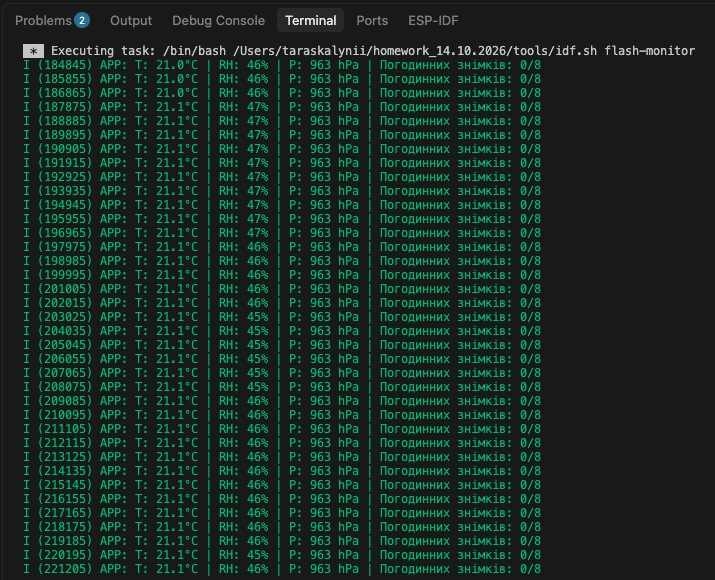

# Модуль 4, урок 4 — BME280 та OLED

ESP32-S3 зчитує температуру, відносну вологість і атмосферний тиск із BME280. Поточні значення оновлюються на OLED SSD1306 раз на секунду та дублюються в серійному моніторі.

## Підключення

| Сигнал | ESP32-S3 |
| --- | --- |
| SDA дисплея та BME280 | GPIO6 |
| SCL дисплея та BME280 | GPIO7 |
| GND | Спільна земля |

Обмін із дисплеєм і датчиком відбувається через I²C на частоті 100 кГц. Адреса SSD1306 — `0x3C`, адреса BME280 визначається автоматично між `0x76` та `0x77`. На перевіреному підключенні датчик відповідає на `0x76` із chip ID `0x60`.

## Екран та історія

- `NOW` — поточні температура в °C, вологість у %RH і тиск у hPa.
- Перший погодинний знімок створюється через годину після запуску.
- Зберігаються 8 останніх знімків. Новий запис замінює найстаріший.
- Історія показується двома сторінками по 4 записи. За наявності понад 4 записів сторінки перемикаються кожні 5 секунд.
- `AGE` показує вік знімка в повних годинах.
- При помилці датчика в момент знімка запис позначається `Err`.
- Історія зберігається в RAM та починається заново після перезапуску.

Оновлення вимірювань виконує таймер LVGL. На старті є пауза 5 секунд для відкриття монітора.

## Збірка та запуск

ESP-IDF 6.1, плата ESP32-S3. Драйвер Bosch BME280 включено до `components/bme280` разом із ліцензією. Компоненти LVGL завантажуються менеджером залежностей ESP-IDF.

```bash
idf.py set-target esp32s3
idf.py build
idf.py -p /dev/cu.usbmodem101 flash monitor
```

## Результат роботи

На скріні видно реальні вимірювання датчика. Лічильник `0/8` означає, що від запуску ще не минула година.



[Перевірки](docs/results.md).
