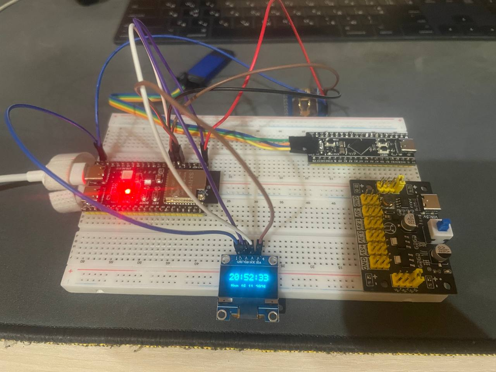

# Модуль 4, урок 3 — I²C годинник

ESP32-S3 зчитує час і дату з RTC DS1307 (`0x68`) і показує їх на SSD1306 128×64 (`0x3C`). На екрані два рядки у форматах `HH:MM:SS` і `EEE DD.MM.YYYY`. Екран оновлюється зі зміною секунди.

Обидва пристрої підключені до спільної шини: SDA — GPIO6, SCL — GPIO7, і спільний GND. Якщо RTC зупинений або має некоректну дату, під час запуску він отримує дату й час збірки.

## Збірка та запуск

ESP-IDF 6.1, ціль ESP32-S3.

```bash
idf.py set-target esp32s3
idf.py -p PORT flash monitor
```

## Результат роботи



[Журнал перевірки](docs/results.md).
