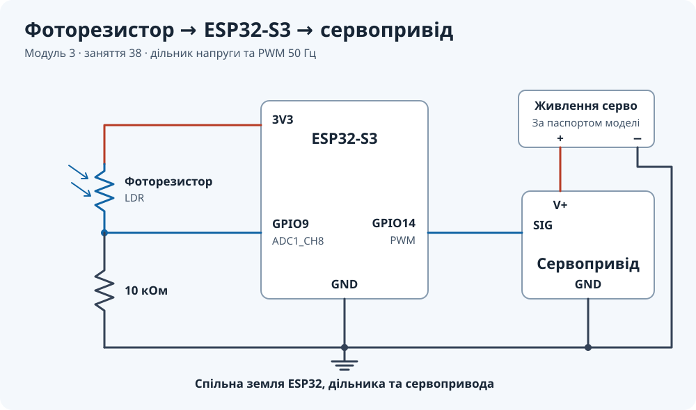

# Модуль 3 · заняття 38 · фоторезистор і сервопривід

Рефакторинг мініпроєкту з LMS для ESP32-S3 та ESP-IDF 6.1. Плата читає
калібровану напругу з фоторезистора, перетворює її на кут і керує серво через PWM.

## Схема підключення



| З’єднання | Куди під’єднати |
|---|---|
| Перший вивід фоторезистора | 3V3 ESP32 |
| Другий вивід фоторезистора | GPIO9 і перший вивід резистора 10 кОм |
| Другий вивід резистора 10 кОм | GND ESP32 |
| Сигнальний провід серво | GPIO14 ESP32 |
| Плюс живлення серво | Плюс зовнішнього джерела з напругою за паспортом серво |
| Мінус живлення серво | Мінус зовнішнього джерела та GND ESP32 |

Дільник живиться від 3,3 В. ESP32 можна живити від USB. GPIO14 передає
керуючий сигнал. Для SG90 перевір напругу своєї моделі, оскільки вона
може відрізнятися між виробниками та версіями.

## Логіка програми

- GPIO9 відповідає ADC1_CH8. ADC працює в режимі oneshot із калібруванням curve fitting.
- Виміряна напруга обмежується діапазоном 50–3000 мВ і переходить у команду 10–170°.
- GPIO14 генерує PWM 50 Гц з роздільністю 12 біт. Duty розраховується за тривалістю
  імпульсу та періодом 20 мс, з округленням після множення.
- Межі імпульсу 1000–2000 мкс узято з попередніх вправ із серво. В оригіналі уроку
  встановлено 500–2500 мкс. Значення `SERVO_MIN_PULSE_US` і `SERVO_MAX_PULSE_US`
  можна підібрати за специфікацією конкретної моделі.
- Кожні 100 мс журнал показує сире значення ADC, напругу, команду кута, імпульс та duty.
  Якщо читання ADC не вдалось, програма пропускає вимірювання й продовжує роботу.

## Перевірка на платі

```bash
bash tools/idf.sh flash-monitor
```

Скрипт налаштований для ESP-IDF 6.1 та плати, яку використовували в попередніх
вправах. У терміналі знайди повідомлення `LDR_SERVO`. Прикрий фоторезистор,
а потім освіти його. Напруга на GPIO9 має зрости від темряви до світла.
Порівняй `voltage` та `angle` і перевір, що вал серво змінив положення.

Для здачі додай результат перевірки на платі в GitHub поруч із кодом та
подай посилання в LMS. Номер модуля і заняття зазначено в назві гілки
`module-3-lesson-38-ldr-servo-refactor`.
