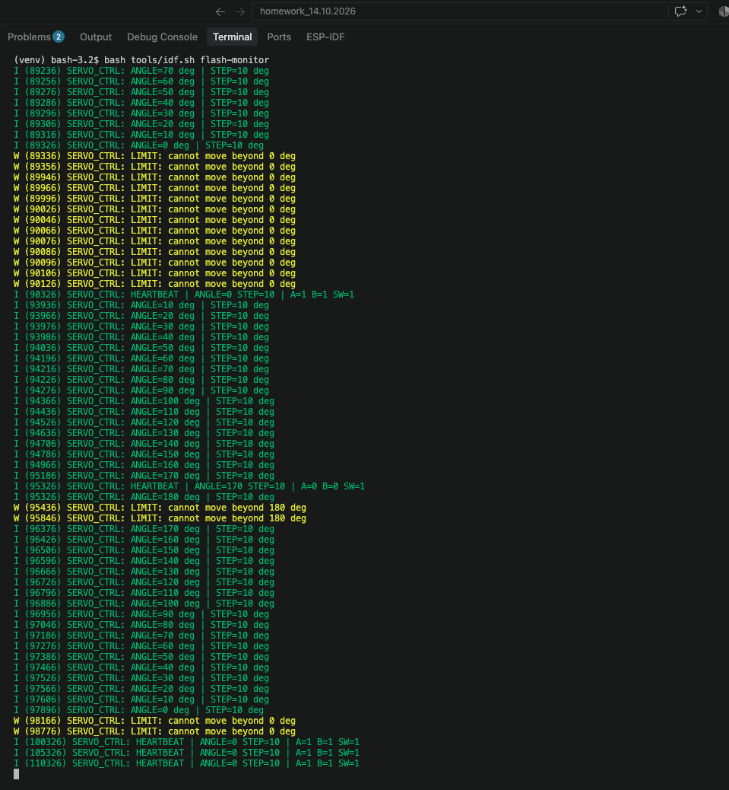

# Модуль 3 — мініпроєкт: керування сервоприводом енкодером (заняття 37)

ESP32-S3, ESP-IDF 6.1. Підключення з попереднього проєкту сейфа збережено.

| Компонент | GPIO |
|---|---:|
| Енкодер A | 5 |
| Енкодер B | 6 |
| Кнопка SW | 7 |
| Серво: сигнал | 1 |
| Бузер | 2 |

Живлення компонентів та спільна земля залишаються як у робочій схемі сейфа.

## Керування

- Після запуску серво переходить на 90°.
- Крок RIGHT додає 10°, LEFT віднімає 10°.
- Коротке натискання перемикає крок 10° / 5°. Перемикання відбувається
  після відпускання кнопки, щоб відрізнити коротке натискання від довгого.
- Утримання кнопки 1 секунду повертає серво на 90°, не змінюючи обраний крок.
- Діапазон команди: 0–180°. Спроба крутити далі за межу вмикає бузер на 120 мс.
- При зміні кроку біля межі кут обмежується до 0 або 180°.
- Натискання обробляються з debounce 30 мс. Звуковий сигнал не блокує цикл.

PWM серво: 50 Гц, імпульс 1000–2000 мкс, як у робочому коді сейфа.
Кут у журналі є командою, а не вимірюванням фізичного положення вала.

## Збірка, прошивання і логи

```bash
bash tools/idf.sh flash-monitor
```

Або Cmd+Shift+B у VS Code. Логи мають тег SERVO_CTRL, HEARTBEAT кожні 5 секунд.
Вихід із монітора: Ctrl+]. Код сейфа збережений окремо в гілці
module-3-miniproject-safe репозиторію TarasKalynii/module-3-lesson-3-pwm.

## Результат виконання

Код зібрано під ESP-IDF 6.1. На наданому скриншоті роботи на ESP32-S3
видно зміну команди кута в обох напрямках із кроком 10°, обмеження 0°/180°,
повідомлення LIMIT при спробі вийти за межі та продовження HEARTBEAT.



[Результати перевірки](docs/results.md) · [Витяг логів](docs/runtime.txt).

Для іншої плати або середовища адаптуй допоміжний скрипт згідно з
[інструкцією прошивання](FLASHING.md).
