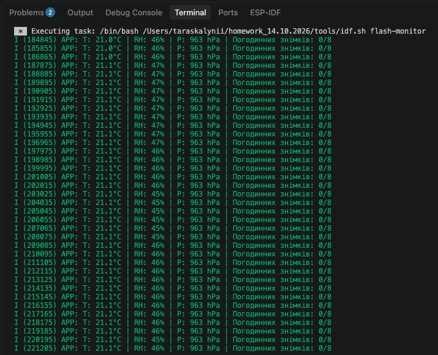

# Перевірка роботи

- Поточний код успішно зібрано в ESP-IDF 6.1 для ESP32-S3.
- У наданому скріні ESP32-S3 виводить температуру близько 21 °C, вологість 45–47 %RH та тиск 963 hPa.
- У попередньому журналі запуску підтверджені адреса BME280 `0x76` і chip ID `0x60`.
- У прискореній перевірці логіки підтверджені перший знімок через годину, відсутність повторних записів у межах години, заміна найстарішого після 8 записів, позначення помилок і перемикання двох сторінок.
- На скріні показано початок роботи до першого погодинного знімка. Повний восьмигодинний сеанс на платі не зафіксовано.

