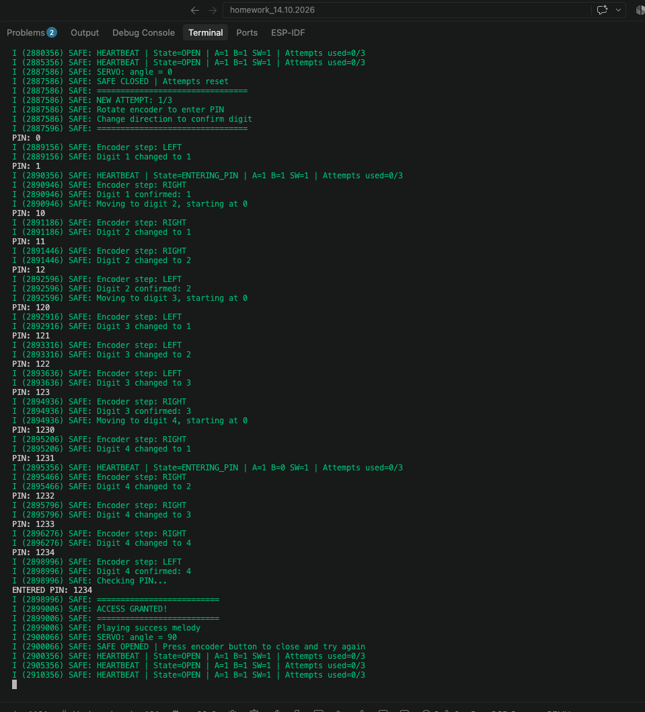
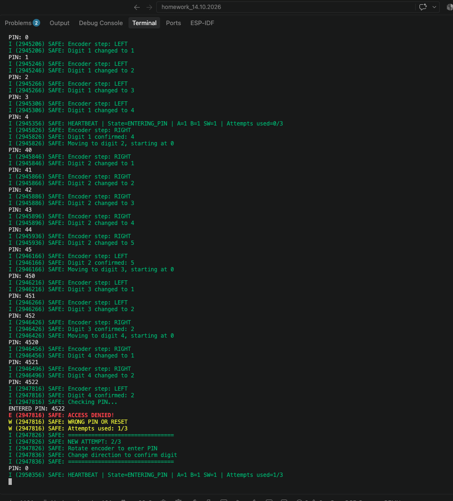

# Результати перевірки — модуль 3, мініпроєкт «Сейф» (заняття 37)

Прошивка: ESP-IDF 6.1, ESP32-S3. Збірка успішна.
Джерело спостережень нижче — два скриншоти serial monitor, надані користувачем 06.11.2026.

| Сценарій | Спостереження в логах |
|---|---|
| Правильний PIN 1234 | ACCESS GRANTED, мелодія успіху, SERVO: angle = 90, SAFE OPENED |
| Кнопка після відкриття | SERVO: angle = 0, SAFE CLOSED, Attempts reset, NEW ATTEMPT: 1/3 |
| Неправильний PIN 4522 | ACCESS DENIED, Attempts used: 1/3, NEW ATTEMPT: 2/3, PIN: 0 |
| Діагностика після відкриття | HEARTBEAT продовжується в стані OPEN |
| Діагностика після помилки | HEARTBEAT продовжується в стані ENTERING_PIN |

Витяги з показаних логів: [правильний PIN](success.txt), [неправильний PIN](failure.txt).
Повідомлення про кут сервопривода підтверджує команду прошивки; скриншот консолі
не є окремим вимірюванням фізичного положення сервопривода або звуку бузера.

Автоматичний вихід із блокування через 30 секунд реалізовано в коді;
на цих двох скриншотах третю невдалу спробу та завершення блокування не показано.

## Оригінальні скриншоти виконання

### Успішне введення PIN 1234

### Неуспішне введення PIN 4522

